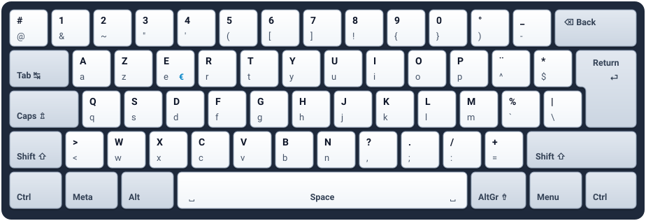

# Custom Azerty (BE) for developers

The goal is a better azerty (be) for developers.
There is only support for X11/Wayland.

**Changes**:
 - ² is replaced with @
 - ³ is replaced with #
 - é replaced with ~
 - § replaced with [
 - è replaced with ]
 - ç replaced with {
 - à replaced with }
 - ^ is not a dead key
 - ù replaced with `
 - µ replaced with \\
 - £ replaced with |
 - ~ is not a dead key



Create the new layout in your home folder:
```sh
mkdir -p ~/.config/xkb/symbols
cat << 'EOF' > ~/.config/xkb/symbols/be
partial alphanumeric_keys
xkb_symbols "developer" {

    include "be(basic)"

    name[Group1] = "Belgian (for developers)";

    key <TLDE>  {[          at,    numbersign, twosuperior,  threesuperior ]};
    key <AE02>  {[  asciitilde,             2,          at,         eacute ]};
    key <AE06>  {[ bracketleft,             6, asciicircum,        section ]};
    key <AE07>  {[bracketright,             7,    braceleft,        egrave ]};
    key <AE09>  {[   braceleft,             9,    braceleft,      ccedilla ]};
    key <AE10>  {[  braceright,             0,   braceright,        agrave ]};
    key <AD11>  {[ asciicircum,dead_diaeresis,  bracketleft,dead_abovering ]};
    key <AC11>  {[       grave,       percent,   dead_acute,        ugrave ]};
    key <BKSL>  {[   backslash,           bar,   dead_grave,            mu ]};
    key <AB10>  {[       equal,          plus,   asciitilde,       sterling]};
};
EOF
```

For Wayland you can register the new layout like this:

```sh
mkdir -p ~/.config/xkb/rules
cat << 'EOF' > ~/.config/xkb/rules/evdev.xml
<?xml version="1.0" encoding="UTF-8"?>
<!DOCTYPE xkbConfigRegistry SYSTEM "xkb.dtd">
<xkbConfigRegistry version="1.1">
  <layoutList>
    <layout>
      <configItem>
        <name>be</name>
      </configItem>
      <variantList>
        <variant>
          <configItem>
            <name>developer</name>
            <description>Belgian (for developers)</description>
          </configItem>
        </variant>
      </variantList>
    </layout>
  </layoutList>
</xkbConfigRegistry>
EOF
```

In X11 you can load it like this in your `.xsession`:
```sh
setxkbmap -I"$HOME/.config/xkb" -layout be_dev -variant developer -print \
              | xkbcomp -I"$HOME/.config/xkb" - "$DISPLAY"
```
But first you need to rename the symbol file `be` to `be_dev` to 
avoid conflicts. 
In the symbol file you also need to replace `include "be(basic)"` 
with `include "be"`.
